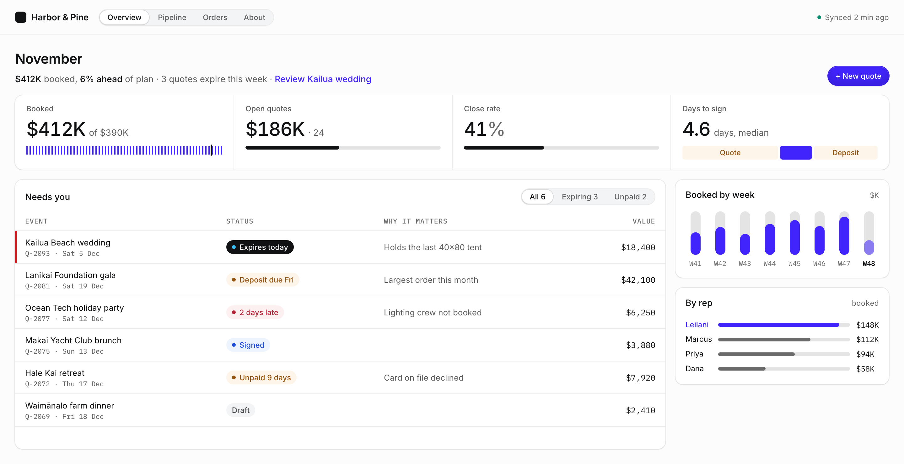
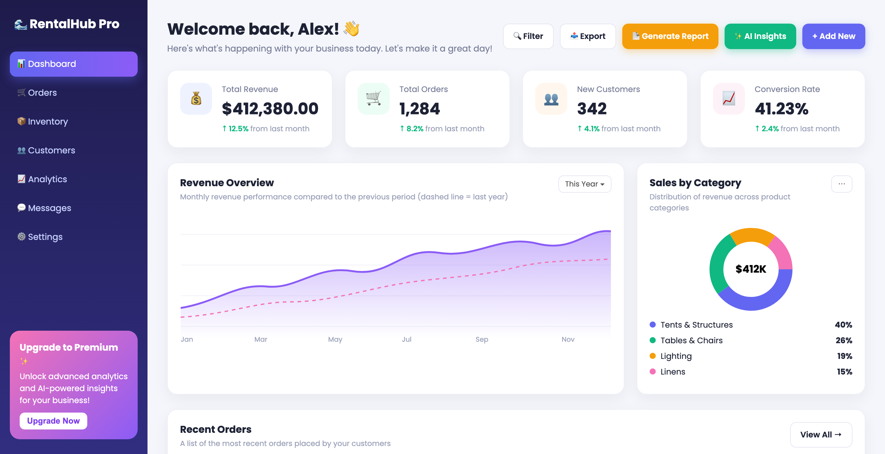
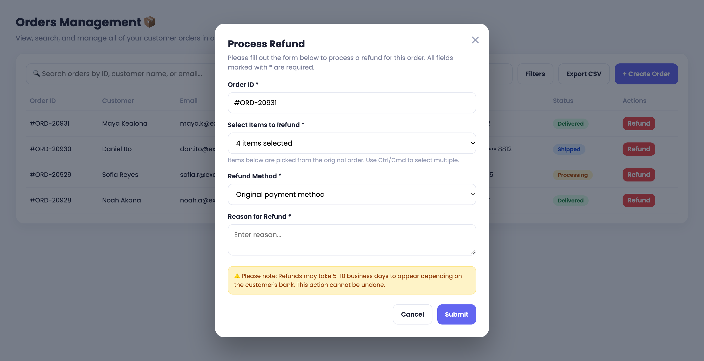
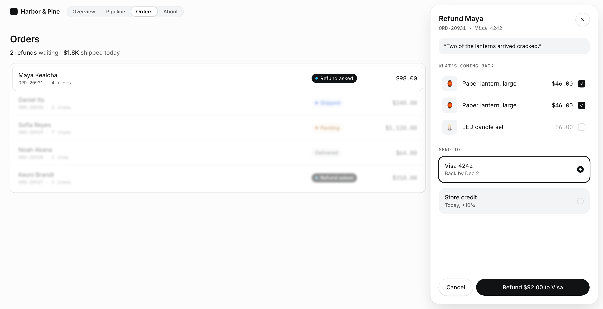

# magic-ui

**A Claude Code skill that makes Claude build dashboards that tell you what to do next.**

Quiet, dense, near-monochrome screens. One accent color. Big numbers, small labels, and a single sentence that tells you where to act. Light and dark themes with measured WCAG contrast. Works with React + Tailwind v4, or as one plain HTML file.

<picture>
  <source media="(prefers-color-scheme: dark)" srcset="docs/img/after-dashboard-dark.png">
  
</picture>

## Before and after

The same screens with the same mock data. **Before** recreates the style that AI tools often produce with no design guidance. **After** follows the magic-ui rules. Both pages are in `docs/showcase/`.

All data on these screens is made up. "Harbor & Pine" is a fictional event-rental company.

### 1. Sales dashboard

**Before**



**After**

<picture>
  <source media="(prefers-color-scheme: dark)" srcset="docs/img/after-dashboard-dark.png">
  
</picture>

| Before | After |
|---|---|
| "Welcome back, Alex! 👋 Here's what's happening…" | One sentence with the facts and the next step: **$412K** booked, **6% ahead** of plan · Review Kailua wedding |
| Five buttons in five colors | One primary button: **+ New quote** |
| "↑ 12.5% from last month" under every number | A number, a muted unit and a meter. Sub-lines only for exceptions |
| "Recent Orders" | **Needs you**: only rows that need action, with a plain-language *Why it matters* column |
| Rainbow status badges | Pill weight follows urgency: black = act now, amber = waiting, red = late |
| Chart captions ("dashed line = last year") | No captions. The current week is lighter because it is still running |

### 2. Refund flow

**Before**



**After**

<picture>
  <source media="(prefers-color-scheme: dark)" srcset="docs/img/after-orders-dark.png">
  
</picture>

| Before | After |
|---|---|
| Modal covers the list | Floating drawer. The list blurs, but the chosen order stays sharp |
| "Reason for refund *" text field | The customer's own words, quoted |
| Multi-select dropdown with "Use Ctrl/Cmd to select…" | Check rows with item and price. Unchecked items are struck through |
| "Refund method" dropdown + 5–10 day warning | Two cards that state the result: **Back by Dec 2** or **Today, +10%** |
| **Submit** | **Refund $92.00 to Visa** |

## What the skill contains

| Path | What it is |
|---|---|
| `SKILL.md` | Entry point. Tells Claude which file to read for which task |
| `references/dashboards.md` | Copy rules, page anatomy, layouts, fit-to-one-screen recipe, checks |
| `references/components.md` | Class recipes for tiles, tables, pills, drawers, filter menus, cmd-K |
| `references/tokens.md` | Light and dark tokens with contrast ratios |
| `references/motion.md` | Easing curves and durations, reduced-motion rules |
| `references/slides.md` | Decks in the same look |
| `assets/magic-tokens.css` | Drop-in Tailwind v4 tokens |
| `assets/magic-plain.css` | The same look without Tailwind, for single HTML files |
| `assets/magic-deck.css` | Slide styles |
| `assets/*.tsx` | React components: segment bar, sparkline, sliding number, filter menu, command palette, sidebar resizer |
| `assets/check-contrast.mjs` | Measures WCAG contrast for every text token in both themes |
| `assets/fit-audit.js` | Checks a page for clipping, scrollbars and word count |
| `docs/showcase/` | The HTML source of the screenshots above |

## Install

Personal (all projects):

```bash
git clone https://github.com/wyatthamilton20-hash/magic-ui ~/.claude/skills/magic-ui
```

One project only (commit it so your team gets it too):

```bash
git clone https://github.com/wyatthamilton20-hash/magic-ui .claude/skills/magic-ui
```

Or with the skills CLI:

```bash
npx skills add wyatthamilton20-hash/magic-ui
```

Restart Claude Code. The skill loads when you ask for a dashboard, console, admin UI or deck. You can also type `/magic-ui`.

## Update

```bash
git -C ~/.claude/skills/magic-ui pull
```

## Try the showcase

Open `docs/showcase/after-dashboard.html` in a browser. Add `#dark` to the URL for the dark theme.

## Credits and license

The visual language comes from [kargulstudio/sales-crm](https://github.com/kargulstudio/sales-crm) (MIT). This project is not affiliated with Kargul Studio. See [NOTICE](NOTICE).

MIT. See [LICENSE](LICENSE).
